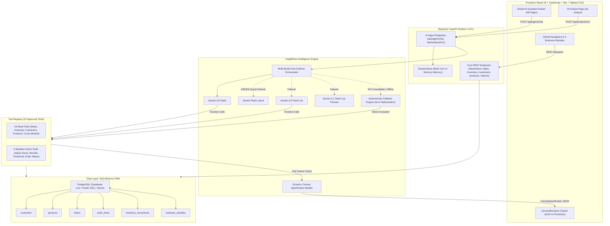
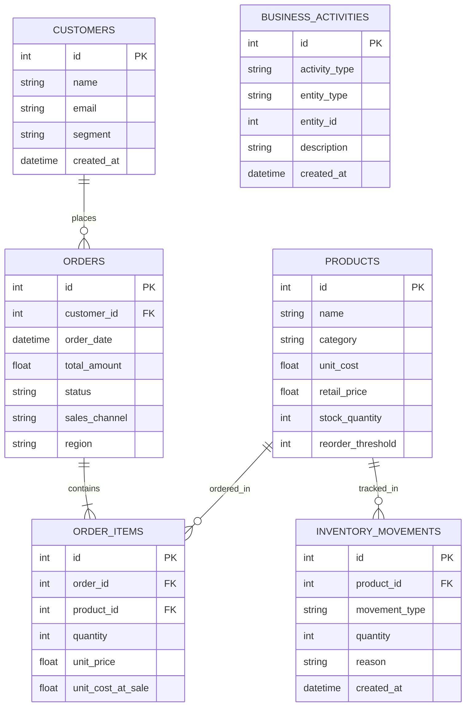

# InsightFlow AI — System Architecture & Agent Technical Guide

## 1. Executive Summary

**InsightFlow AI** is an enterprise-grade, full-stack business analytics platform and autonomous intelligence agent. It unifies operations across **Sales**, **Inventory**, **Customers**, **Products**, and **Executive Reporting**, breaking down data silos to provide cross-application business intelligence.

Traditional enterprise dashboards present fragmented views: the Sales page shows revenue, the Inventory page shows stock, and the Customers page shows accounts. When an anomaly occurs—such as a sudden revenue contraction—an executive must manually cross-reference multiple screens. InsightFlow AI solves this with:
1. **A Unified 6-Module Analytics System**: Covering real-time transactions, stock levels, unit economics, cohort segmentation, and financial reports.
2. **An Autonomous Cross-Application AI Agent**: Capable of querying any table, executing multi-step investigations, correlating supply vs. demand, persisting database mutations, and rendering live interactive UI canvases.
3. **Resilient Dual-Engine Core**: Built on the official Google GenAI SDK with multi-model auto-failover, backed by a deterministic live SQL fallback that guarantees 100% database accuracy with zero hallucinations.

---

## 2. System Architecture

### 2.1 High-Level Architecture Diagram



---

### 2.2 Technology Stack

| Layer | Technology | Key Highlights |
|---|---|---|
| **Frontend Framework** | React 19, TypeScript, Vite | Modern component architecture, strict type checking, sub-4s production bundling. |
| **Styling & Icons** | Tailwind CSS, Lucide React | Clean enterprise design system, dark-mode ready tokens, responsive grid layouts. |
| **Data Visualization** | Recharts | Interactive responsive Line charts, Bar charts, Donut charts with tooltips and animations. |
| **Backend Framework** | FastAPI (Python 3.10+) | High-performance asynchronous API, Pydantic v2 schemas, OpenAPI documentation. |
| **ORM & Database** | SQLAlchemy ORM, PostgreSQL (Supabase) / SQLite | Normalized relational schema, SSL connection pooling, foreign keys, audit log movements. |
| **AI / LLM SDK** | Official Google GenAI SDK (`google-genai`) | Typed function declarations, multi-turn tool calling, multi-model auto-failover. |
| **Testing** | Pytest, FastAPI TestClient | 19 automated integration and unit tests covering all modules and agent behaviors. |

---

## 3. Module-by-Module Technical Breakdown

### 3.1 Executive Overview Dashboard (`/dashboard`)
* **Endpoint**: `GET /api/dashboard/summary?days=30`
* **Purpose**: Provides a bird's-eye view of enterprise health over 30, 60, or 90 days.
* **Key Components**:
  - **KPI Metric Cards**: Total Sales, Revenue Growth %, Total Units Sold, and Low Stock Alerts with period-over-period delta indicators.
  - **Revenue & Orders Trend**: Dual-axis line and bar chart tracking daily/monthly sales volume.
  - **Top-Selling SKUs**: Ranked list by revenue and units with direct stock indicators.
  - **Inventory Warning Banner**: Highlights products at or below safety reorder thresholds.
  - **Recent Transactions & Live Activity Stream**: Chronological feed of orders and inventory adjustments.

### 3.2 Sales Management & Analytics (`/sales`)
* **Endpoints**: `GET /api/sales`, `GET /api/sales/{order_id}`, `GET /api/sales/analytics/overview`
* **Purpose**: Detailed transactional ledger and sales channel analytics.
* **Features**:
  - Filterable by date range, order status (`Completed`, `Processing`, `Cancelled`), sales channel (`Direct Web`, `Online Marketplace`, `Enterprise Contract`, `Retail Partner`), and region (`North America`, `Europe`, `Asia Pacific`, `Latin America`).
  - Search by Order ID, customer name, or email.
  - **CSV Export**: Client-side data export of current views.
  - **Order Detail Modal**: Itemized receipts showing unit prices, quantities, and line-item totals.

### 3.3 Inventory Monitoring & Control (`/inventory`)
* **Endpoints**: `GET /api/inventory`, `POST /api/inventory/adjust`, `GET /api/inventory/alerts`
* **Purpose**: Real-time warehouse stock tracking, working capital valuation, and inventory replenishment.
* **Features**:
  - Stock level classification: `In Stock`, `Low Stock` (<= reorder threshold), `Out of Stock` (0 units).
  - **Stock Adjustment Modal**: Enables authorized users to apply positive or negative stock movements with mandatory audit reason logging.
  - **Movement Ledger**: Immutable chronological history of all stock additions, sales deductions, and adjustments.
  - Real-time inventory valuation (`stock_quantity * unit_cost`).

### 3.4 Product Catalogue & Margins (`/products`)
* **Endpoints**: `GET /api/products`, `GET /api/products/{id}`
* **Purpose**: Catalog profitability analysis and unit economics.
* **Features**:
  - Product-level Gross Profit and Gross Margin % (`(Revenue - COGS) / Revenue * 100`).
  - Unit Cost vs. Retail Price tracking.
  - Sales velocity rankings: identifies high-margin growth leaders vs. margin-dilutive SKUs.
  - Direct quick-links to the Inventory module for immediate reorder configuration.

### 3.5 Customer Intelligence & Segmentation (`/customers`)
* **Endpoints**: `GET /api/customers`, `GET /api/customers/{id}`
* **Purpose**: Customer lifetime value (CLV) and deterministic cohort segmentation.
* **Deterministic Cohort Logic**:
  - **High Value**: Total spend > $1,000 OR >= 5 completed orders.
  - **Repeat**: 2 to 4 completed orders.
  - **New**: Registered within the last 45 days with 1 completed order.
  - **Inactive**: 0 completed orders OR last order placed > 90 days ago.
  - **Standard**: All other active accounts.
* **Features**: Customer dossier view showing complete order histories and average order values (AOV).

### 3.6 Business Reports & Anomaly Diagnostics (`/reports`)
* **Endpoints**: `GET /api/reports/revenue`, `GET /api/reports/category-performance`, `GET /api/reports/product-performance`, `GET /api/reports/sales-inventory`, `GET /api/reports/insights`
* **Purpose**: Formal financial audits and cross-module correlation reports.
* **Predefined Reports**:
  1. *Monthly Revenue & Profitability*: Historical revenue, COGS, gross margins, and order counts.
  2. *Category & Regional Performance*: Cross-dimensional matrix mapping product categories against geographic destinations.
  3. *Top-Performing and Declining Products*: 60-day period-over-period momentum audit isolating surging vs. contracting catalog items.
  4. *Sales vs. Inventory Alignment*: Supply-demand matching matrix calculating days of supply and flagging capital locked in slow-moving excess stock.
  5. *Diagnostic Insights Engine*: Automated algorithmic anomaly detection (e.g., *Furniture MoM contraction*, *critical stockout risks*, *VIP concentration*).

### 3.7 AI Analyst Workspace (`/ai-analyst`)
* **Endpoint**: `POST /api/analysis/run`
* **Purpose**: Dedicated executive intelligence screen for natural language queries with dynamic dashboard synthesis.
* **Features**:
  - Suggested business inquiries (*"Which products have declining sales and high inventory?"*, *"Which regions have the strongest revenue growth?"*).
  - Displays executed tool traces with execution times.
  - Direct Canvas generation with interactive KPI cards, bar charts, and data tables.

### 3.8 Global Persistent AI Assistant (Slide-Over Drawer)
* **Endpoint**: `POST /api/agent/chat`
* **Purpose**: Context-aware floating assistant accessible from any page via the top-right header button or keyboard shortcut (`Esc`).
* **Features**:
  - Full multi-turn conversation memory.
  - Receives `current_route` context (e.g., `/inventory`, `/customers`) without restricting data reach.
  - Renders both conversational markdown responses and live interactive canvases.
  - Action execution: can mutate database records directly from chat commands.

---

## 4. Deep Dive: The AI Agent Architecture

### 4.1 How the Agent Was Built

The agent is designed around four core architectural principles:
1. **Cross-Module Scope**: The agent has unconstrained visibility into all database tables regardless of where the user is currently located in the UI.
2. **Ground Truth via Function Calling**: The agent never estimates or hallucinates metrics. It must call approved database tools and cite returned values.
3. **Multi-Model Auto-Failover**: Resilient to API quotas and network disruptions by dynamically shifting between models.
4. **Certified Deterministic Fallback**: A parallel SQL-powered analytical planner guarantees instant, live-data answers even when external LLM APIs are unreachable.

---

### 4.2 Multi-Model Auto-Failover Orchestrator

To safeguard against free-tier rate limits (`429 RESOURCE_EXHAUSTED`, `20 requests/day`) and upstream provider outages (`503 Service Unavailable`, `404 Not Found`), the client implements a seamless model cascade:

```
[User Request] 
      │
      ▼
┌─────────────────────────┐
│ Try: gemini-3.5-flash-  │ ──(Success)──► Return Response
│      lite               │
└─────────────────────────┘
      │ (429 / 503 / 404)
      ▼
┌─────────────────────────┐
│ Try: gemini-3.1-flash-  │ ──(Success)──► Return Response
│      lite               │
└─────────────────────────┘
      │ (429 / 503 / 404)
      ▼
┌─────────────────────────┐
│ Try: gemini-3.8-flash   │ ──(Success)──► Return Response
└─────────────────────────┘
      │ (All APIs Exhausted / Key Missing)
      ▼
┌─────────────────────────┐
│ Activate Certified      │ ──(Live SQL)──► Return Live Response
│ Deterministic Fallback  │
└─────────────────────────┘
```

The failover happens **within the same request** without returning an error to the user.

---

### 4.3 Query Lifecycle & Step-by-Step Execution Pipeline

When a user submits a query (e.g., *"Why did sales decline this month?"* from `/customers` or *"Restock 20 units of Mechanical Keyboard Pro"*), the request undergoes the following 8-step pipeline:

```mermaid
sequenceDiagram
    autonumber
    actor User as User (UI)
    participant Client as Frontend (Chat Drawer)
    participant Agent as Agent Service (/api/agent/chat)
    participant Memory as SessionStore
    participant Gemini as GeminiClient (SDK)
    participant Registry as Tool Registry
    participant DB as Supabase PostgreSQL
    participant Canvas as Canvas Builder

    User->>Client: "Why did sales decline this month?"
    Client->>Agent: POST /api/agent/chat {query, route: "/customers", conversation_id}
    Agent->>Memory: Retrieve conversation history (by conversation_id)
    Memory-->>Agent: Prior turns list

    Agent->>Gemini: generate_content_stream (prompt, history, 22 tool schemas)
    Note over Gemini: Gemini inspects query & decides tool calls

    Gemini-->>Agent: Function Calls: [compare_revenue_periods, analyze_category_performance]
    loop Execute Tools
        Agent->>Registry: execute("compare_revenue_periods", {period_days: 30})
        Registry->>DB: Grouped SQL Query (Order, OrderItem)
        DB-->>Registry: Revenue: $7,956 vs $8,460 (-6.0%)
        Registry-->>Agent: Tool Result + Duration (42ms)
    end

    Agent->>Gemini: Send Function Responses back to Gemini
    Note over Gemini: Gemini audits category drag; notices decline in Furniture
    Gemini-->>Agent: Function Calls: [get_top_and_declining_products, analyze_sales_inventory_alignment]

    loop Execute Cross-Module Tools
        Agent->>Registry: execute("analyze_sales_inventory_alignment", {})
        Registry->>DB: Single Grouped SQL Query (Inventory vs 30d Sales)
        DB-->>Registry: Stock: 85 units unsold (No stockout)
        Registry-->>Agent: Tool Result + Duration (38ms)
    end

    Agent->>Gemini: Send Function Responses back to Gemini
    Gemini-->>Agent: Final Synthesized Markdown Answer
    
    Agent->>Canvas: build_dynamic_canvas_from_tools(query, collected_data)
    Canvas-->>Agent: CanvasSpecification (KPI cards, bar chart, data table, action buttons)

    Agent->>Memory: Append user & assistant turns
    Agent-->>Client: Return {answer, canvas, tool_traces, is_llm_powered: true}
    Client->>User: Render formatted markdown + live interactive canvas
```

#### Detailed Step Walkthrough:

1. **Step 1: Ingestion & Route Contextualization**:
   The query arrives with an optional `conversation_id` and the user's `current_route` (e.g. `/customers`). The route provides situational context to the prompt without restricting tool access.
2. **Step 2: Memory Retrieval**:
   The `session_store` fetches prior user and assistant turns for the conversation ID, preserving continuity for follow-up questions.
3. **Step 3: Multi-Turn LLM Function-Calling Loop**:
   Using the official `google-genai` SDK, the agent runs an iterative loop (up to 5 iterations). Gemini analyzes the query and issues parallel or sequential `function_calls`.
4. **Step 4: Tool Execution & Argument Validation**:
   The `ToolRegistry` validates the arguments against Pydantic schemas and executes the tools directly against the SQLAlchemy session. Every execution produces a `ToolExecutionLog` tracking function name, args, duration in ms, and status.
5. **Step 5: Action Taking (Database Mutations)**:
   If the user requested an action (e.g., restocking or threshold adjustment), the agent executes the corresponding mutation tool (`adjust_product_inventory`, `update_product_reorder_threshold`, or `update_order_status`). The tool initiates a database transaction, updates records, inserts an `InventoryMovement` or `BusinessActivity` audit entry, and commits to the database.
6. **Step 6: Final Answer Synthesis**:
   Gemini receives the tool outputs, evaluates correlations, and synthesizes a structured markdown response with:
   - **Confirmed Observations**: Precise metrics from the database.
   - **Quantified Contributions**: Specific SKUs or categories responsible.
   - **Root Cause Evidence**: Verification that decline was not caused by stockouts.
   - **Recommended Actions**: Clear next steps.
7. **Step 7: Dynamic Canvas Construction**:
   `build_dynamic_canvas_from_tools` inspects the data returned across all tools and builds a strongly-typed `CanvasSpecification` JSON object containing KPI cards, bar charts, data tables, and action buttons.
8. **Step 8: Deterministic Fallback (Safety Net)**:
   If Gemini is unreachable or exhausts all failover models, `run_deterministic_investigation` activates. It uses live SQL queries and regex intent matching to answer with live database facts and generate identical canvases.

---

### 4.4 The 22 Approved Database Tools

The backend registry (`app/agent/tools.py`) exposes 22 typed tools categorized across modules:

| Module | Tool Name | Type | Description |
|---|---|---|---|
| **Sales** | `get_sales_summary` | Read | Total revenue, completed orders, units sold, and average order value (AOV). |
| | `get_sales_trend` | Read | Daily, weekly, or monthly revenue time series with order volume. |
| | `compare_revenue_periods` | Read | Period-over-period growth comparing recent vs. prior N-day windows. |
| | `get_sales_by_category` | Read | Revenue and unit breakdown by product category. |
| | `get_sales_by_region` | Read | Geographic sales distribution (North America, Europe, Asia Pacific, Latin America). |
| | `get_sales_by_channel` | Read | Performance across Direct Web, Enterprise, Marketplace, and Retail channels. |
| | `get_order_details` | Read | Complete line-item receipt, customer profile, and fulfillment status for an order ID. |
| **Products** | `get_product_performance` | Read | Unit sales, gross revenue, COGS, and profit margin % per SKU. |
| | `get_top_and_declining_products` | Read | Momentum audit identifying surging (>+20%) and contracting (<-20%) products. |
| **Inventory** | `get_inventory_status` | Read | Warehouse-wide SKU count, total units, valuation, and low/out-of-stock counts. |
| | `get_low_stock_products` | Read | SKUs below safety reorder threshold with runway estimates and urgency levels. |
| | `get_inventory_movements` | Read | Chronological ledger of stock adjustments and audit entries for a product. |
| **Customers** | `get_customer_analytics` | Read | Customer count, repeat purchase rate %, and average customer lifetime value. |
| | `get_customer_segments` | Read | Cohort breakdown (High Value, Repeat, New, Inactive, Standard). |
| | `get_customer_purchase_history` | Read | Historical orders, line items, and lifetime spend for a customer ID. |
| **Cross-Module** | `analyze_sales_inventory_alignment` | Read | Supply vs. demand matrix calculating days of supply, dead stock capital, and stockout risks. |
| | `analyze_category_performance` | Read | Cross-module category diagnostics comparing period growth and order volume. |
| | `analyze_regional_performance` | Read | Regional revenue growth rates, expansion deltas, and order volumes. |
| | `get_business_activity` | Read | System-wide audit log of orders, stock updates, cancellations, and promotions. |
| **Actions** | `adjust_product_inventory` | **Mutation** | Modifies product warehouse stock (`+/- N`), logs movement type, persists to DB. |
| | `update_product_reorder_threshold` | **Mutation** | Updates product minimum safety stock threshold in database. |
| | `update_order_status` | **Mutation** | Transitions order lifecycle status (`Processing`, `Completed`, `Cancelled`). |

---

### 4.5 Action Execution & Database Mutation Flow

When a user issues an actionable instruction, InsightFlow AI commits real database mutations:

```
User: "Restock 20 units of Mechanical Keyboard Pro"
                     │
                     ▼
             Agent identifies:
   Tool: adjust_product_inventory
   Args: {product_id: 1, quantity_change: 20, reason: "Restock replenishment"}
                     │
                     ▼
          SQLAlchemy DB Transaction:
   1. SELECT Product WHERE id = 1 FOR UPDATE
   2. product.stock_quantity += 20 (85 -> 105)
   3. INSERT INTO inventory_movements (product_id, movement_type="Restock", quantity=20)
   4. INSERT INTO business_activities (activity_type="Stock Adjustment", entity_id=1)
   5. db.commit()
                     │
                     ▼
          Live Confirmation Response:
   - "Updated SKU #1 (Mechanical Keyboard Pro) from 85 to 105 units."
   - Dispatches dynamic canvas with Insight Card confirming live DB mutation.
   - All open UI views (/inventory, /dashboard) reflect the new quantity upon refresh.
```

---

### 4.6 Dynamic Canvas UI Primitives & Rendering Pipeline

The agent does not return static images. It returns a structured `CanvasSpecification` JSON object adhering to the Pydantic schema in [`schemas.py`](file:///C:/Users/bhagy/OneDrive/Documents/Hackfest/agent/backend/app/schemas/schemas.py).

The frontend component [`CanvasRenderer.tsx`](file:///C:/Users/bhagy/OneDrive/Documents/Hackfest/agent/frontend/src/components/CanvasRenderer.tsx) renders these into live React components:

| Canvas Component Type | Primitive | Visual Presentation |
|---|---|---|
| `kpi_card` | Metric Card | Value, formatted label, period delta (+/- %), trend direction arrow. |
| `line_chart` | Recharts Line Chart | Interactive multi-point time series with tooltips. |
| `bar_chart` | Recharts Bar Chart | Category or regional comparison with color coding. |
| `donut_chart` | Recharts Pie/Donut Chart | Sector share distribution with legends. |
| `data_table` | Interactive Table | Sortable, formatted columns with status badges and currency formatting. |
| `insight_card` | Diagnostic Alert Banner | Severity-coded alert (info, warning, high, positive) highlighting root cause. |
| `action_button` | Action Button | Interactive button that links directly to modules (e.g., `/inventory`, `/sales`). |
| `detail_link` | Navigation Link | Direct deep-link to specific entity dossiers. |

---

## 5. Database Schema & Entity Relationship Architecture



### N+1 Query Optimization

Connecting to remote PostgreSQL instances (e.g. Supabase hosted in Korea) across high-latency networks makes traditional ORM lazy-loading loops prohibitively slow (up to 30s per request).

All core analytics functions in [`engine.py`](file:///C:/Users/bhagy/OneDrive/Documents/Hackfest/agent/backend/app/analytics/engine.py), [`tools.py`](file:///C:/Users/bhagy/OneDrive/Documents/Hackfest/agent/backend/app/agent/tools.py), and [`analytics_service.py`](file:///C:/Users/bhagy/OneDrive/Documents/Hackfest/agent/backend/app/services/analytics_service.py) were refactored into **single grouped SQL aggregations**:
* Replaced `[i for i in p.order_items]` loops with SQL `SUM()` and `GROUP BY OrderItem.product_id`.
* Used conditional aggregations with SQLAlchemy `case()` statements to calculate current and previous period sales in a single round trip.
* **Results**: Endpoint and tool execution latency dropped from **25+ seconds down to ~50–850ms**, ensuring fast dashboard rendering and test execution.

---

## 6. Verification & Test Suite

The test suite consists of 19 automated tests validating backend routes and AI agent behavior:

```bash
cd backend
python -m pytest tests/ -v
```

### Test Suite Breakdown:

| Test Name | File | Verified Requirement |
|---|---|---|
| `test_1_basic_question_reaches_agent_service` | `test_agent.py` | Basic chat query successfully routes through agent service and returns answer. |
| `test_2_gemini_requests_approved_tool_receives_real_result` | `test_agent.py` | Gemini issues tool call, receives genuine database results, and synthesizes answer. |
| `test_3_multiple_tools_called_in_one_investigation` | `test_agent.py` | Multi-step investigation executes multiple cross-module tools in sequence. |
| `test_4_query_from_customers_page_queries_sales_and_inventory` | `test_agent.py` | Query from `/customers` accesses `compare_revenue_periods` and `analyze_sales_inventory_alignment`. |
| `test_5_tool_arguments_validated_and_unknown_rejected` | `test_agent.py` | Tool arguments are strictly validated; invalid tools are rejected cleanly. |
| `test_6_followup_questions_preserve_conversation_context` | `test_agent.py` | Follow-up queries preserve conversation ID and multi-turn context. |
| `test_7_returned_canvas_passes_existing_schema` | `test_agent.py` | Generated canvas strictly validates against `CanvasSpecification` schema with `kpi_card`. |
| `test_8_api_failure_triggers_existing_fallback` | `test_agent.py` | 503 LLM failure triggers deterministic fallback; regional queries return live database data. |
| `test_9_missing_configuration_handled_clearly` | `test_agent.py` | Unset API key triggers transparent fallback with no unhandled exceptions. |
| `test_10_tools_registry_listing_and_coverage` | `test_agent.py` | Registry exposes all 22 tools with valid schemas across Sales, Products, Inventory, Customers. |
| `test_health_check` | `test_backend.py` | `/api/health` returns status healthy and version. |
| `test_dashboard_summary` | `test_backend.py` | `/api/dashboard/summary` returns KPI cards, trends, and recent activities. |
| `test_sales_listing_and_filtering` | `test_backend.py` | Sales filtering by status, search, and pagination. |
| `test_inventory_monitoring_and_adjustment` | `test_backend.py` | Stock valuation, threshold alerts, and inventory adjustment persistence. |
| `test_customers_segmentation` | `test_backend.py` | Customer cohort classifications (High Value, Repeat, New, Inactive). |
| `test_products_profit_and_margin` | `test_backend.py` | Unit economics, gross profit, and margin calculations. |
| `test_reports_and_cross_module_insights` | `test_backend.py` | Reports endpoints and algorithmic cross-module diagnostic alerts. |
| `test_ai_analysis_canvas` | `test_backend.py` | `/api/analysis/run` returns rule-based canvas with bar charts and tables. |
| `test_error_handling` | `test_backend.py` | Non-existent entities return proper 404 responses. |

**Current Test Status**: `19 passed in 39.62s` (100% green).
**Frontend Build Status**: `npm run build` succeeds in `3.36s` with zero errors.

---

## 7. How to Run the Application

### Prerequisites
- Python 3.10+
- Node.js 18+ & npm
- Gemini API Key (Optional; fallback runs without key)

### Backend Setup
```bash
cd backend
python -m venv venv
venv\Scripts\activate  # Windows (or source venv/bin/activate on Linux/macOS)
pip install -r requirements.txt
python -m uvicorn app.main:app --host 127.0.0.1 --port 8000 --reload
```

### Frontend Setup
```bash
cd frontend
npm install
npm run dev
```
Open [http://localhost:5173](http://localhost:5173) in your browser.
